<div align="center">

# The Museum of My Mind

**A quiet, private place to see your thoughts, sort them, and find your way when life feels crowded.**

Your goals become stars, your projects become planets, and the thoughts you have not dealt with yet drift between them like dust, until you are ready.

[**Open the museum →**](https://museum-of-my-mind.pages.dev)  ·  no account  ·  nothing to install  ·  works offline  ·  your data never leaves your device unless you choose

<br>

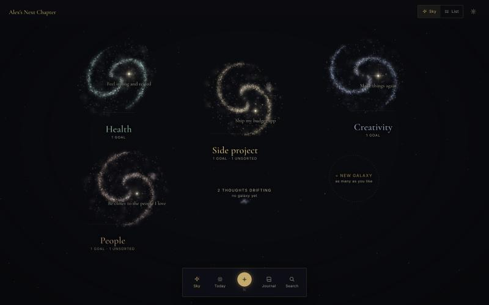

<sub>Every screenshot in this README shows <b>Alex</b>, a made-up person whose example museum ships with the app. No real person's data appears anywhere.</sub>

</div>

---

## Contents

1. [Why this exists](#why-this-exists)
2. [What it is, in one minute](#what-it-is-in-one-minute)
3. [A walk through the museum](#a-walk-through-the-museum)
4. [How to use it](#how-to-use-it)
5. [How to make the best use of it](#how-to-make-the-best-use-of-it)
6. [Principles it will not break](#principles-it-will-not-break)
7. [Your privacy and your data](#your-privacy-and-your-data)
8. [How it works (technical deep dive)](#how-it-works)
9. [How it was made](#how-it-was-made)
10. [Run it yourself](#run-it-yourself)
11. [Known limits and what's next](#known-limits-and-whats-next)
12. [Licence and credits](#licence-and-credits)

---

## Why this exists

A mind is full. It holds goals you have carried for years, ideas that arrived on a bus, half-made plans, questions you keep circling, worries, small wins, and memories you do not want to lose. Most of it is never sorted. It sits in the back rooms of your head like a museum after closing time: everything in it matters to someone, but the lights are off, nothing has a label, and the dust is settling.

When it piles up, two things happen. You stop seeing what you actually care about, and every new idea feels like one more thing to carry.

Most tools answer this with lists: tasks, deadlines, red numbers, streaks. Those are useful for work. They are a poor fit for the inside of a life. A thought like *"Is the gym worth it, or is running enough?"* is not a task. Neither is *"Plan a weekend away with my sister"* until you have decided you want it.

**The Museum of My Mind takes the other road.** It treats your mind as a place you can walk around in:

- **Each area of your life is a galaxy:** health, a side project, creativity, the people you love, or anything else you choose.
- **A goal is a star.** It is a direction you could follow for years, with one line about *why* it matters to you. The more recently a goal has moved, the brighter its star burns. One you have not touched in weeks fades gently. It is never shamed.
- **Projects are planets** that orbit their goal. Each one has a ring of light that closes as it progresses.
- **Unsorted thoughts drift as soft dust** inside their galaxy, or between galaxies if they do not belong anywhere yet. Nothing is lost there, and nothing nags.
- **Open questions flicker** until you write an answer, even a rough one.
- **The journal** keeps what happened and how it felt, in your own words, apart from your goals. Months later, *On this day* brings it back.

You capture without deciding. Later, when you are calm, you give each thought a home. Once a week you take two quiet minutes to see what moved and what went quiet. That is the whole idea: **a museum for the mind, never a task tracker.**

---

## What it is, in one minute

| | |
|---|---|
| **What** | A personal, local-first web app that shows your goals, projects, thoughts, questions and memories as a living 3D night sky. You can also read it all as a plain list. |
| **Who it's for** | Anyone whose head feels crowded: people with a full-time job who are slowly making room for health, a side project, creativity and relationships. |
| **Where your data lives** | In your own browser (IndexedDB). There is no account, no login, no hosted database and no analytics. |
| **Devices** | Mac, Windows, iPhone, Android. It installs as an app (PWA) and works fully offline after the first visit. |
| **Moving between devices** | An optional end-to-end-encrypted sync, paired by scanning a QR code. You can also use a single backup file. |
| **AI** | Optional and off by default. The museum is complete without it. If you switch it on, you bring your own Anthropic key, it is held in tab memory only, and you see exactly what will be sent before anything leaves. |
| **Cost** | Free. It runs on Cloudflare Pages' free plan. |

---

## A walk through the museum

### 1. The whole mind

Every galaxy is one area of a life. Labels show how many goals each one holds and how many thoughts are still unsorted. Thoughts with no galaxy yet drift in the middle. Click a galaxy and the camera flies into it.

### 2. A galaxy, and the dust of unsorted thoughts

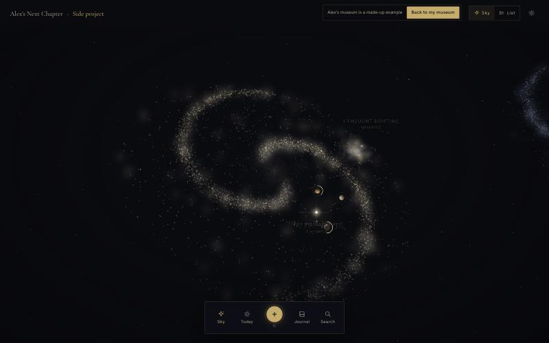

### 3. A goal's solar system

Click a star and the camera settles beside it. Its projects orbit as planets, and each planet's arc of light shows how far along it is. Orbits slow down under your pointer so they are easy to click. A small card gives you the goal's *why* without leaving the sky.

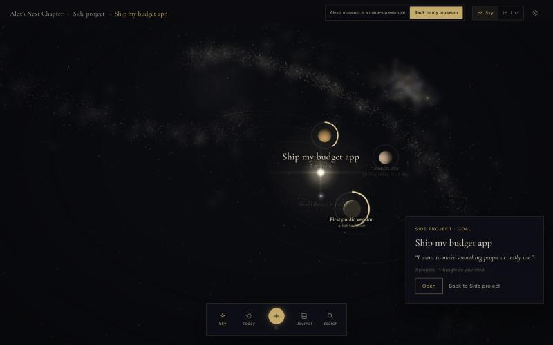

### 4. The goal page, beside its star

Opening a goal slides its page in beside the sky. The page holds the goal's *why*, the thoughts and questions on your mind about it, and its projects with their shapes.

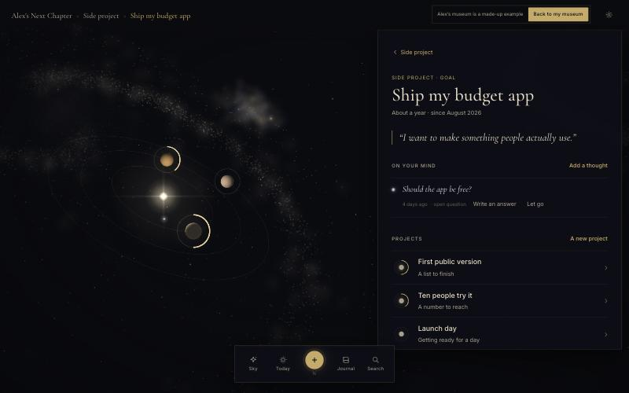

### 5. A project, and its honest pace

Every project has a **shape**. *Ten people try it* is a number to reach. Each person adds one, and the ring closes. Below the ring sits a calm **what-if**: *if you keep this pace, you get there around November.* The page says plainly that this is a what-if, not a promise.

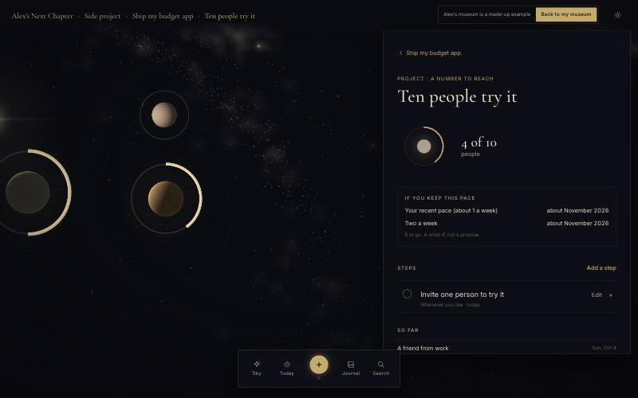

### 6. Capture, in one tap

The gold button (or the **N** key) opens Capture from anywhere. Type a few words and save. You can say what it is (a thought, a question, a step or a memory) and where it goes, but you never have to.

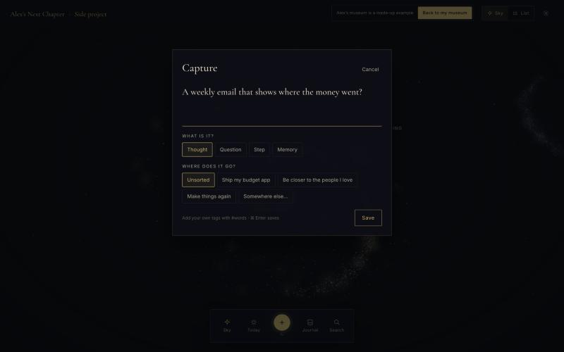

### 7. Unsorted: sorting, when you are calm

Everything you captured without a home waits here. Give each one a home (a goal, a project or a galaxy), turn it into a step, a goal or a project, or let it go. The museum suggests a likely home from the words you used. It never decides for you.

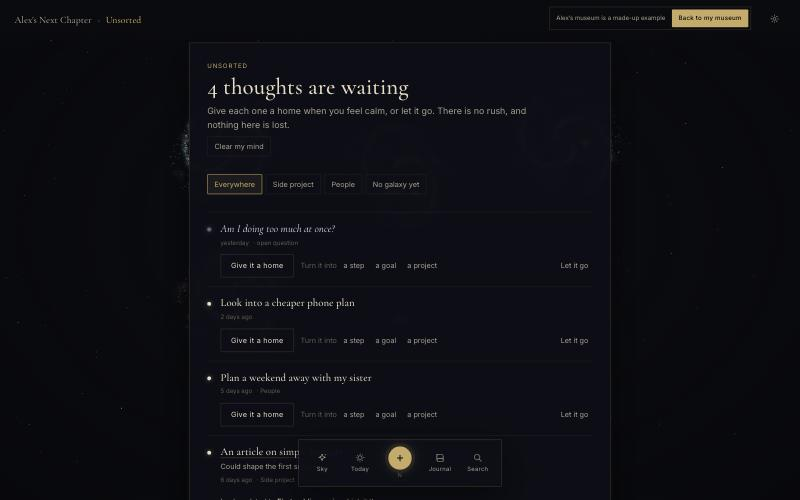

### 8. Today stays small

Each day: **one thought to sit with**, then **at most two goals with one step each**. There are no streaks, no red numbers and nothing overdue. A missed day simply waits.

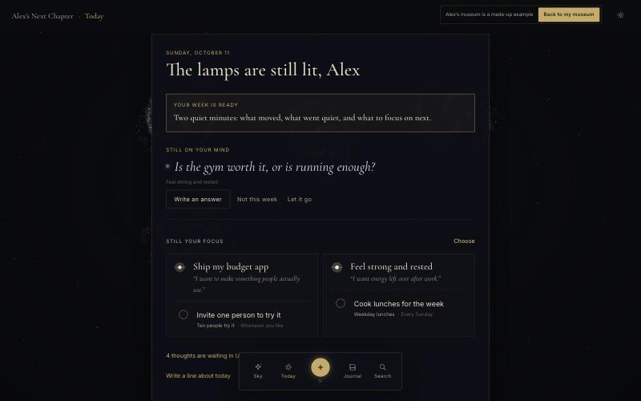

### 9. Two quiet minutes on Sunday

The weekly review shows what moved, what went quiet, how many thoughts are waiting and which questions are still open. Then you choose one or two goals to focus on next week, and Today will show only those. It is all worked out on your device, with no AI needed.

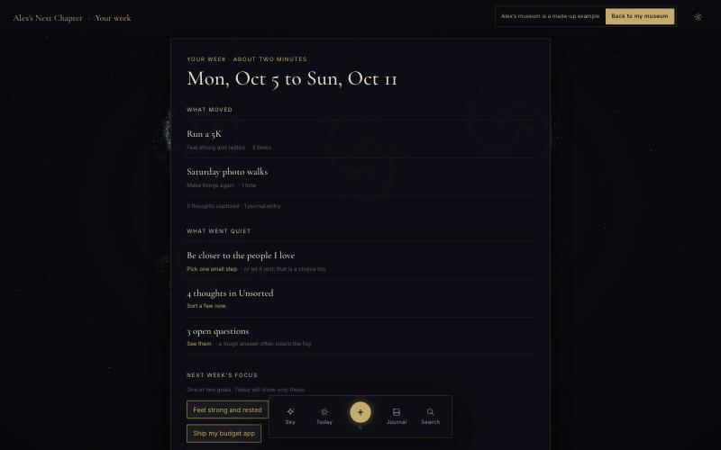

### 10. On a phone

The same museum, the same feel. On a phone the galaxies stack, the dock sits under your thumb, and pages rise as a sheet with the sky still visible above.

<p align="center">
  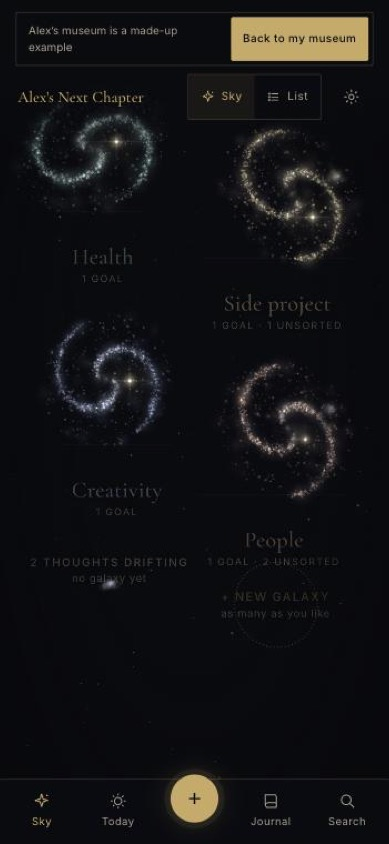
  &nbsp;&nbsp;
  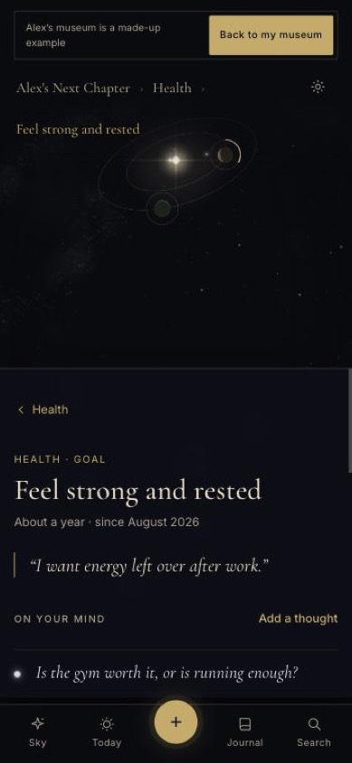
</p>

### 11. The guided tour

First-time visitors get a one-scroll tour of Alex's museum. The 3D sky acts out each chapter as you read: a thought flies in, finds a home, a goal lights up, a project closes its ring.

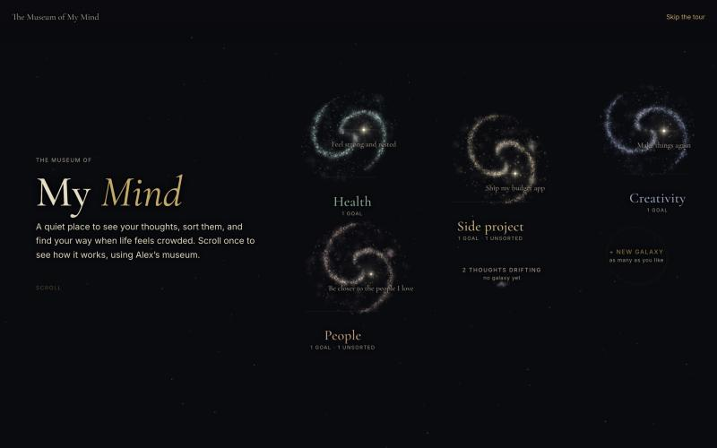

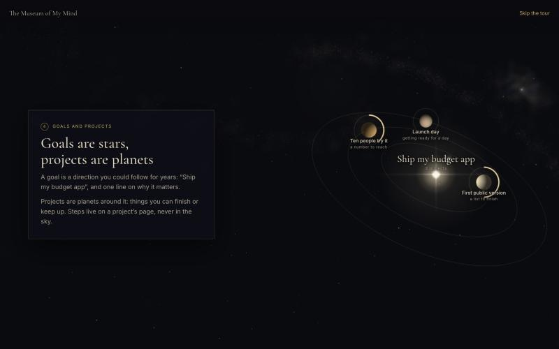

---

## How to use it

### Getting started (one minute)

1. **Open** <https://museum-of-my-mind.pages.dev>.
2. **Scroll the tour** (about a minute), or tap *Skip to the start*.
3. **Begin your own museum.** Your name is optional. Name the museum and your first galaxy (for example *Personal*).
4. Or choose **Wander Alex's museum first** to click around a full example. A small notice keeps *Make my own* one tap away, and Alex's museum resets itself every two weeks, so you cannot break it.
5. **Install it** (recommended): *Settings › Add the museum to this device*. On iPhone, use Safari's *Share › Add to Home Screen*. Installed, it opens like an app and works offline.

### The bottom dock

| | What it does |
|---|---|
| **Sky** | Your whole mind. Click a galaxy, then a star, then a planet. Each level is also a real URL, so the back button and links work. |
| **Today** | One thought to sit with, plus at most two goals with one step each. |
| **＋ (gold)** | Capture. Also **N** on a keyboard. |
| **Journal** | What happened and how it felt, by day, with *On this day* memories. |
| **Search** | Everything, instantly. Also **/** or **⌘K**. |

Top right: **Sky / List** switches between the 3D sky and a plain, fully accessible list of the same things. The gear opens **Settings**. **Esc** steps back out one level.

### Capturing

- Tap **＋**, type, and press **Save** (or ⌘/Ctrl + Enter).
- **What is it?**
  - *Thought*: the default.
  - *Question*: it will flicker in the sky until answered. A thought ending in "?" becomes a question automatically.
  - *Step*: it waits in Unsorted until you give it a project.
  - *Memory*: it goes straight to the journal.
- **Where does it go?** *Unsorted* (the default), straight to a goal, or *Somewhere else…*. You can add **#tags** inline.
- **Clear my mind** (from Unsorted) is for when your head is full: write one thought per line, and everything is captured at once.

### Sorting (when calm, never in a rush)

Open **Unsorted** (*Today* tells you how many are waiting). For each thought:

- **Give it a home**: a goal, a project, or simply a galaxy. A thought linked to a goal circles that star like a moon.
- **Turn it into…** a step, a goal or a project, when it has grown into one.
- **Let it go**. It leaves every view but is never hard-deleted, so a backup still holds it.
- **Write an answer** to a question. A rough answer counts, and often clears the fog.
- **Not this week** (on Today) rests a question for a while, without letting it go.

### Galaxies, goals, projects and steps

```
Mind ─┬─ Galaxy (an area of life)     e.g. Health
      │    └─ Goal (a star)           e.g. Feel strong and rested · "I want energy left over after work."
      │         └─ Project (a planet) e.g. Run a 5K           ← has a shape
      │              └─ Step          e.g. Run 20 minutes     ← has a kind
      ├─ Thoughts (drifting, kept, or let go)
      ├─ Journal entries
      └─ Weekly reviews
```

**A goal** has a horizon (a season, a year, years or a lifetime) and a state: *active*, *resting*, *reached* or *released*. Releasing a goal is a respectable choice, not a failure.

**Every project has one of six shapes**, so progress means something real:

| Shape | Example | Progress is… |
|---|---|---|
| **A list to finish** | *First public version* | steps done out of steps planned |
| **A number to reach** | *Ten people try it* | a count toward a target, in your own unit |
| **A habit to keep** | *Run three times a week* | sessions per week, with no streaks |
| **Getting ready for a day** | *Launch day* | a date, and what is ready for it |
| **A climb in levels** | *Beginner → Intermediate → Confident* | the level reached |
| **A question to explore** | *Is a standing desk worth it?* | open until you write a conclusion |

**Steps come in six kinds.** Only some of them ever reach Today, so the daily view stays small:

| Kind | Meaning | On Today? |
|---|---|---|
| **Once** | Do it one time | ✓ |
| **Repeat** | Every day, on weekdays, weekly, every *n* days, or *n* times a week | ✓ when due |
| **Session** | A stretch of practice with an amount (for example 20 minutes or 3 pages) | ✓ when due |
| **Waiting** | Waiting on someone or something, in your words | ✗ |
| **Someday** | Not now, not forgotten | ✗ |
| **Milestone** | A marker worth noticing when you pass it | ✗ |

Completing a step logs it, with an optional note. **Undo** is always one tap away.

### Today

Today picks your focus goals in this order:

1. the goals you chose in this week's review;
2. otherwise, last week's choice;
3. otherwise, it *suggests* the two goals that moved most recently, and says that it is a suggestion.

For each focus goal it offers **one** step: anything due today from a repeat or session, otherwise the next one-off step in that goal's liveliest project. The thought of the day is an open question you have not looked at recently, or a kept thought you have not visited in three weeks. It changes once a day, not every time you open the app.

### Journal

Write *what happened and how it felt*, by day. Entries can be linked to a goal or project, but they don't have to be. **On this day** brings back what you wrote one, three or six months ago, and a year ago.

### The weekly review

On Sunday (or Monday, if you missed it) Today invites you to **Your week**. In about two minutes it shows:

- **What moved:** projects with progress, and how many times.
- **What went quiet:** active goals with no movement, with a gentle *Pick one small step*, or *let it rest; that is a choice too*.
- **What's waiting:** unsorted thoughts and open questions.
- **Next week's focus:** pick one or two goals. Today will show only those.

### Search

Search covers galaxies, goals, projects, steps, thoughts and journal entries. Matching uses a small on-device stemmer, so *play*, *plays* and *playing* find each other.

### Your devices (sync)

*Settings › Your devices*:

1. On your first device, choose **Turn on sync**. A QR code and a typed code appear.
2. On your second device, choose **Join a museum from another device**, then scan the QR code with the camera or type the code.
3. That's it. Changes flow both ways in the background whenever you are online.

Lost a phone? Choose **Replace the code**. Every device holding the old code is locked out, and your own devices join again with the new one.

### Backups

*Settings › Backup › Export* saves one JSON file that holds everything. **Import** restores it anywhere, losslessly. Backups exist even if you never use sync. Keep one somewhere you trust.

### Ask my AI (optional, off by default)

In the weekly review you can ask your own Claude to reflect on your week. Before anything is sent, the museum shows the **exact items**, their size and the model. Your Anthropic key is used once, held only in this tab's memory, and never stored. You decide what to do with every suggestion.

---

## How to make the best use of it

These habits come from using it every day. None of them are rules.

1. **Capture without deciding.** The moment a thought arrives, tap ＋, write five words and save. Sorting is a different mood. Doing both at once is how lists become heavy.
2. **Sort when you are calm.** Pick a quiet evening and open Unsorted with a cup of something. Give homes, turn things into steps, and let go generously. A let-go thought is not lost; it is just no longer yours to carry.
3. **When your head is loud, use Clear my mind.** Write everything, one line each, for five minutes. Then close it. The relief is the point.
4. **Write your *why* in one honest line.** *"I want energy left over after work"* will pull you further than *"Get fit."* You will read that line every time you open the goal.
5. **Turn worries into questions.** *"Am I doing too much at once?"* flickering in the sky is easier to face than a vague unease. Write an answer when you can, even a bad one, and revise it later.
6. **Focus on at most two goals a week.** The weekly review asks you to choose. Everything else keeps its place in the sky; nothing is abandoned by not being chosen.
7. **Give each project its true shape.** If it's really a habit, don't make it a list. If it's really a question, let it be one. The right shape makes the progress ring honest.
8. **Let stars fade.** A dim star is information, not guilt. Either pick one small step, set the goal to *resting*, or release it.
9. **Use the journal for feelings, not achievements.** *"Photo walk by the canal. Low light, lovely colours. Two photos I actually like."* Those are the entries *On this day* brings back.
10. **Take the Sunday two minutes.** It is the one ritual that keeps everything else light.
11. **Install it, and pair your phone.** Capture happens on the phone; sorting often happens on the laptop. Sync makes them one museum.
12. **Export a backup now and then.** Browsers can clear site data, and Safari in particular may clear it for sites you don't visit. An installed app and a recent backup make that a non-event.

---

## Principles it will not break

These are written into the project's [`CLAUDE.md`](CLAUDE.md) as permanent rules.

- **Mind first, never a task tracker.** No streaks, no overdue, no red badges, no productivity scores.
- **Private by construction.** Your data stays on your device, with no account, no telemetry, no analytics, no third-party scripts and no hosted database of readable data.
- **Lossless.** Nothing is ever hard-deleted by normal use. Exports round-trip byte for byte, and every old record survives every migration.
- **Honest numbers.** A pace is labelled as a what-if, never a prediction.
- **Calm, legible, beautiful.** 3D is used only where it creates wonder (the sky). Everything you read is fast, flat and accessible.
- **Works for everyone.** It honours *reduced motion*, every control has a 44px touch zone, every text field is at least 16px (so iOS never zooms), and the sky always has a plain-list equivalent.

---

## Your privacy and your data

| Question | Answer |
|---|---|
| Where is my data stored? | In your browser's IndexedDB, on your device. |
| Does the server see it? | No. The site is static files. Two tiny serverless functions exist: the sync mailbox, which only ever receives ciphertext, and the optional AI relay, which forwards one request you confirmed and stores nothing. |
| Is there an account? | No. Nobody, including the maker, can see who uses it. |
| Analytics or tracking? | None. There are no third-party scripts at all. |
| What does sync store? | A random mailbox id, a *hash* of a device token, random-looking item ids, timestamps, sizes, and AES-256-GCM ciphertext. The keys never leave your paired devices. |
| Where is my AI key? | In this tab's memory only. It is never written to storage, backups, URLs, logs or the server. It is sent once per request you confirm, and forgotten when you close the tab or tap *Forget*. |
| Can I take everything with me? | Yes. One export file holds every record, in readable JSON. |

---

## How it works

### Stack

| Layer | Choice | Why |
|---|---|---|
| UI | **React 19** + **TypeScript 7** (strict, with `exactOptionalPropertyTypes` and `noUncheckedIndexedAccess`) | Correctness on a data model that must never lose anything |
| Build | **Vite 8** | Fast builds, and code splitting per place |
| State | **Zustand** | Small, explicit stores |
| Storage | **IndexedDB** through `idb` | The only database. It is local and survives restarts. |
| 3D | **three.js 0.186**, used directly with custom shaders (no React Three Fiber) | Full control of the render loop, picking, and camera flights |
| Routing | **react-router 7** | Every view of the sky is a URL |
| Offline | **vite-plugin-pwa** (Workbox) | Installable, precached and auto-updating |
| Hosting | **Cloudflare Pages** with Pages Functions and **D1** | Free static hosting, and a mailbox for encrypted sync |
| Tests | **Vitest** + `fake-indexeddb` | Real storage behaviour in tests |

There are only ten runtime dependencies. The main script is about **130 KB gzipped**. three.js (about 145 KB gzipped) loads lazily, only when the sky is shown, and never on the first-impression path.

### Architecture

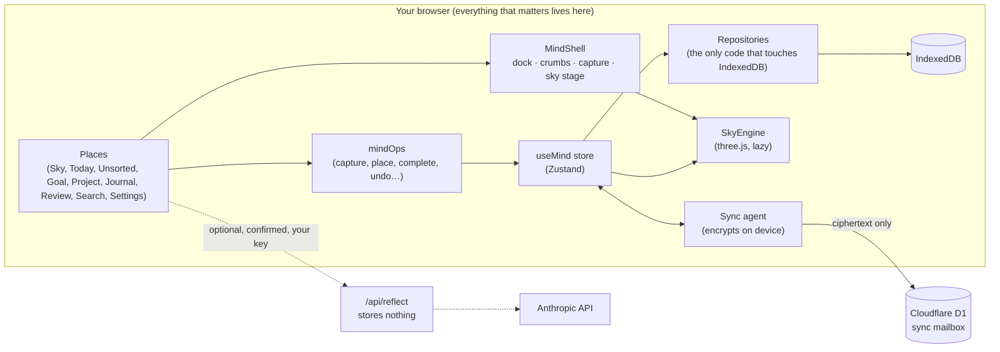

The layering is strict: **components call stores, stores call repositories, and only repositories touch IndexedDB.** Every place (page) is lazy-loaded through a small `lazyRoom` wrapper. If a page was left open across a deploy and its old chunk has vanished, the wrapper reloads once, with a loop guard, instead of crashing.

### The data model

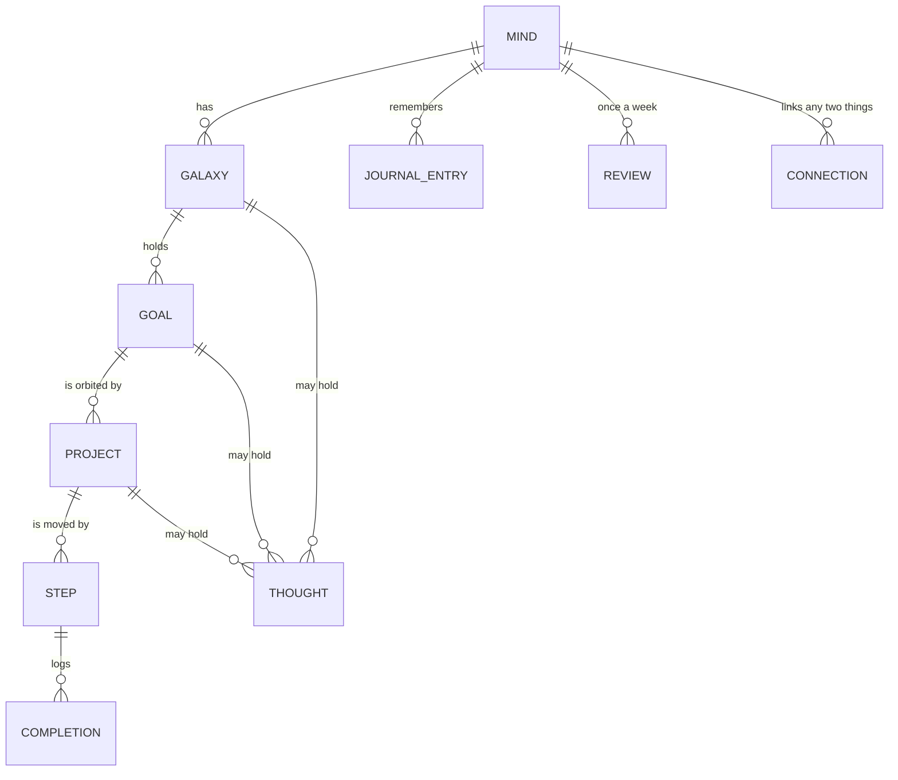

- Every record carries `createdAt`, `updatedAt` and `lastVisitedAt`. Deletion is a `deletedAt` marker, never an erase, which is what makes sync and lossless backups possible.
- **Project shapes** and **step kinds** are discriminated unions, so TypeScript makes it impossible to, for example, give a habit a target date.
- **Repeat rules** (`day`, `weekdays`, `week`, `n-days`, `times-per-week`) are evaluated by a pure `isDue` / `nextDue` module that is tested across week and month boundaries.
- **Lossless migration.** The app began as a six-room museum (Observatory, Archive, Workshop, Future Gallery, Cabinet). When it was redesigned around the mind, a one-time switch-over did three things:
  - it wrote a full **pre-move backup** first;
  - it migrated every record into the new model, with notes, ideas and links becoming thoughts and wall threads becoming links;
  - it kept anything with no new home (for example old "what-if" scenarios) as `legacy` records, so a backup still round-trips byte for byte.

  The old stores are left untouched.

### The sky engine

The sky is a hand-written three.js engine (`src/sky/engine.ts`). It is not a scene graph library.

- **Galaxies** are point clouds drawn with custom additive shaders: spiral arms, a soft haze layer, and a calm core. A point-size scale (`uScale`) keeps galaxies looking like galaxies rather than rings at every zoom.
- **Determinism.** Every galaxy is generated from a seeded PRNG (`mulberry32`) keyed on the galaxy's id. The same museum always draws the same sky, on every device and after every edit.
- **Stars** brighten with how recently their goal moved: full brightness for a goal touched today, fading over about two weeks to a floor of 35%. Nothing ever goes dark.
- **Planets** carry a progress arc computed from their project's shape. **Moons** are thoughts linked to a goal. **Flickering points** are open questions. **Dust** is unsorted thoughts.
- **Routes drive the camera.** `/`, `?galaxy=`, `?goal=`, `/goal/:id` and `/project/:id` each map to a view. Changing the URL starts an eased **camera flight**. When a page opens beside the sky, the engine shifts the projection with `setViewOffset`, so the star sits in the open space beside the page on a laptop and above the sheet on a phone. The back button flies you back.
- **Picking** uses screen-space distance rather than raycasting, so small, far-off stars are still easy to hit with a finger. Orbits **slow down** under a pointer or finger.
- **Labels** are real DOM text (crisp, selectable and translatable), positioned each frame, with a collision pass that hides lower-priority labels when they would overlap.
- **Legibility over bright arms.** Each name has a soft dark glow behind it, which is invisible on open sky. The point shader also thins a galaxy's arms to 60% around each goal star, with a wider clearing when seen from afar, so a star and its name always sit in calm space.
- **Motion** honours `prefers-reduced-motion`: flights become cuts, and drift stops.
- **Fallbacks.** Without WebGL the museum shows a plain star field and the List view. Nothing depends on 3D.

### Smart, but on your device

There is no AI in the core loop. The "smart" parts are small, readable functions:

- **Suggested homes** (`suggestHome`): stem the words of a thought, score overlap against each active goal's and project's title and *why*, prefer the narrower home on a tie, and suggest nothing unless something clearly matches.
- **Today** (`planToday`): focus goals come from your review, then last week's, then a labelled suggestion. There is one step per goal, and the thought of the day is seeded by the date so it stays put all day.
- **The weekly review** (`weekSummary`): what moved, what went quiet, and what's waiting, computed from completions, logs and timestamps.
- **What-if pace** (`recentPace`, `whatIfDate`): the average over your last eight weeks of real progress, projected forward and labelled as a what-if.

### Encrypted sync, paired by QR code

The goal was to keep a Mac and an iPhone in step **without accounts and without a server that can read anything.**

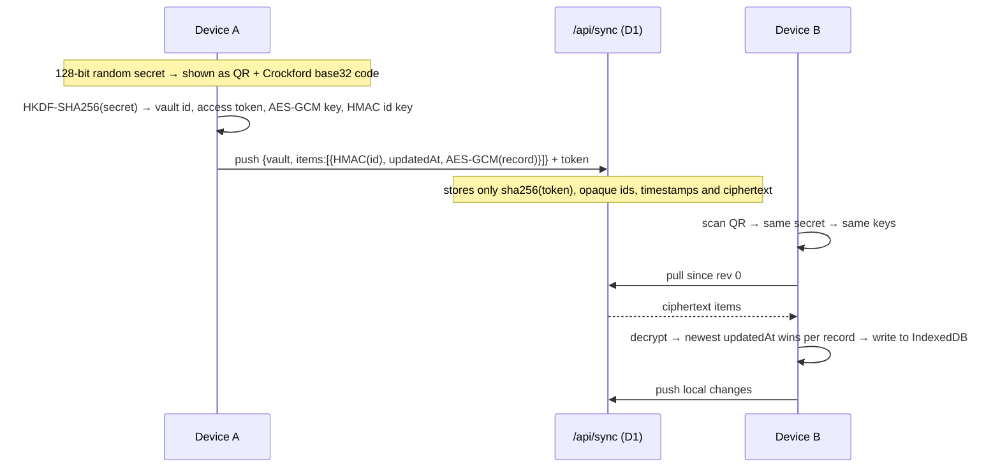

- **The pairing code** is 128 random bits written in Crockford base32 with a check character, so a mistyped code is caught before anything is sent.
- **Key derivation.** HKDF-SHA256 derives four independent values from the secret:
  - the mailbox name;
  - the access token (the server keeps only its SHA-256 and compares it in constant time);
  - the AES-256-GCM key, used with a fresh 12-byte nonce per record;
  - an HMAC key that hides even record ids from the server.
- **Merge.** Last write wins per record, by the record's own `updatedAt`. Deletions travel as ordinary edits, because nothing is ever erased.
- **Watermarks and echoes.** The push watermark is capped at the current time, so a record stamped in the future (a fast clock, an import) can never hide later edits. An echo map stops a device re-sending what it just received.
- **Server hardening.** The server checks the origin, limits body size, item count and blob size, and enforces a 50 MB per-vault quota maintained by SQL triggers. It returns error codes only and logs nothing.
- **Recovery.** *Replace the code* forgets the old vault. A lost device holding the old code gets `unpaired`.
- **Proof.** The round is written as pure functions (`pullAll`, `mergeIncoming`, `applyWrites`, `pushChanges`) and tested against an in-memory fake server, including two-device round trips and clock-skew cases.

### Ask my AI: bring your own key, safely

- The key lives in a JavaScript variable in the current tab. It is never stored in `localStorage`, IndexedDB, backups, URLs or logs.
- Before sending, you see every item that will be sent, the byte size, and the model.
- `functions/api/reflect.ts` checks the origin and the key's shape, validates the request against a shared schema, forwards it once, validates the structured result, and returns a short error code on failure. It stores and logs nothing.
- There is no deployment-owned key, so nobody's credits can be spent but yours.

### Offline, install and updates

- Workbox precaches the whole app (about 58 files), so after the first visit the museum opens with no network at all.
- `registerType: 'autoUpdate'` with `skipWaiting` and `clientsClaim` means updates install themselves. A notice inside the app could never rescue someone stuck on a broken boot.
- `lazyRoom` recovers from stale chunks after a deploy, as described above.
- Opening IndexedDB is guarded by a timeout, with a clear message if another tab is holding an upgrade.

### Accessibility and touch

- **Sky / List**: every star, planet and thought in the sky is also in a semantic list.
- Modals make the page behind them `inert`, focus is managed, and **Skip to content** is present.
- A **44px touch zone** on every control on touch screens, **16px minimum** text in every field, visible focus rings, and `prefers-reduced-motion` honoured in every animation.
- A release-time **pointer audit** (`scripts/pointer-audit.js`) runs inside the real page at phone and desktop sizes. It checks that every visible control is actually the top-most element at its own centre, which catches buttons hidden under sheets or overlays that a scripted `.click()` would wrongly report as working.

### Testing

- **69 tests in 11 files** cover:
  - the recurrence rules and calendar edge cases;
  - all six project shapes' progress and pace;
  - the v3 → mind migration and the pre-move backup;
  - backup round-trips and dangling-reference checks on the demo;
  - Today's selection rules and the weekly summary;
  - the store's boot and landing logic (a first-time visitor is never stranded inside the demo);
  - the full sync protocol against a fake server.
- The suite runs on **real IndexedDB semantics** via `fake-indexeddb`.
- TypeScript runs in its strictest practical configuration, and `npm run build` fails on any type error.
- Every phase was checked live in a real browser at phone and desktop sizes, with real clicks, before shipping.

---

## How it was made

### The approach

The museum was built in **18 numbered phases over four weeks** (14 September to 11 October 2026). Each phase was planned and approved, then built, verified in a real browser, committed and deployed. If anything looked wrong, the fix was a one-command revert to the previous commit.

**Design came first, in a throwaway prototype.** The 3D sky was prototyped and judged by eye before any production code was written. Real feedback ("the galaxy centre is too bright", "a person can have multiple galaxies", "clicking a planet should open its page") shaped the engine.

**Real use drove the rest.** The original six-room museum shipped first. Using it every day showed that rooms were the wrong metaphor for a crowded mind, and that led to the **mind-first redesign** (Phases 10–17): one mind, many galaxies, goals as stars, and a firm rule that it must never become a task tracker.

| Phase | What shipped |
|---|---|
| 0 | Docs, data layer, app shell, entrance, PWA |
| 1 – 6 | The original museum: a 3D Observatory, the Archive wall, the Workshop, the Future Gallery (a seeded what-if simulator), the Cabinet of Curiosities, settings and polish |
| 7 | **Ask my AI**, bring-your-own-key, with a relay that stores nothing |
| 8 | Production readiness and free deployment on Cloudflare Pages |
| 9 – 9.1 | Daily-use simplification, and fixes from the first real week of use |
| 10 | Design-direction prototype for the mind-first sky |
| 11 | New model (galaxies, goals, projects with six shapes, steps with six kinds), lossless migration, backups |
| 12 | Shell, dock, Capture, Unsorted, Clear my mind, Search, and the switch-over |
| 13 | Goal and project pages, all six shapes, every step kind, and Today |
| 14 | The production 3D sky: galaxies, solar systems, thoughts, and the List view |
| 15 | Journal, *On this day*, and the weekly review |
| 16 | The guided tour, retiring the old rooms, and full release checks |
| 17 | End-to-end-encrypted sync, paired by QR code |

The full plan, with every decision and its reason, is in [`docs/implementation-plan.md`](docs/implementation-plan.md). The product brief, the design system and the architecture are in [`docs/`](docs).

### Who did what

The concept, product direction, design decisions, feedback and testing are by **Vandan Lalwani** ([@vandanlalwani-git](https://github.com/vandanlalwani-git)). That includes the idea of the mind as a dusty museum, the choice of stars over task lists, the six step types, the "mind first, never a task tracker" rule, every approval, and daily real-world use.

The code was implemented in partnership with **Claude Code**, Anthropic's AI coding agent. It worked phase by phase under that direction and to the written rules in [`CLAUDE.md`](CLAUDE.md): it planned, wrote the code and tests, verified each change in a real browser, and reported back for approval before anything shipped.

### A few problems worth telling

- **Galaxies that looked like rings.** Point-size attenuation made spiral arms collapse into hoops when the camera came close. Fixed with a scale uniform and a separate haze layer.
- **The engine rebuilt itself on every click.** React Router's `navigate` changes identity on each navigation, which re-ran the effect that created the WebGL engine. Fixed by holding it in a ref and setting the model and view on creation.
- **A sync that quietly stopped.** One early-return path never cleared the agent's "running" flag, so later rounds were skipped forever. Fixed with `.finally()` and a test.
- **A watermark from the future.** A record stamped ahead of the clock moved the push watermark past real edits. It is now capped at the current time, and versions already sent are remembered.
- **Strangers stranded in the demo.** An early build could open straight into Alex's museum with no way to begin your own. Boot now detects that state, and a permanent *Make my own* notice is shown inside the demo.
- **Tests that lied.** A hidden browser tab throttles animation frames, and scripted `.click()` ignores whatever is drawn on top of a button. The answer was the pointer audit and a rule that release checks use real clicks.

---

## Run it yourself

### Locally

```bash
git clone https://github.com/vandanlalwani-git/museum-of-my-mind.git
cd museum-of-my-mind
npm ci
npm run dev        # http://localhost:5173
```

| Command | What it does |
|---|---|
| `npm run dev` | Development server with hot reload |
| `npm test` | The full test suite (Vitest) |
| `npm run typecheck` | Strict TypeScript check |
| `npm run build` | Type-check, then build the static site into `dist/` |
| `npm run preview` | Serve the production build locally |

To run the serverless functions (sync and the AI relay) locally too:

```bash
npx wrangler d1 migrations apply museum-sync --local
npm run build && npx wrangler pages dev dist --port 8788
```

### Project layout

```
src/
  app/        App, routes, lazyRoom (safe updates across deploys)
  mind/       The model: types, store, ops, repositories, migration, backup,
              recurrence, shapes, Today, week, demo (Alex), search
  sky/        The three.js engine, sky model, route → camera mapping
  shell/      MindShell, dock, crumbs, capture sheet, demo notice
  places/     Sky, Today, Unsorted, Clear, Search, Goal, Project, Journal,
              Review, Settings (+ Devices), Tour, Welcome, Join
  sync/       Pairing code, key derivation, the sync round, the agent
  ai/         Ask my AI client (key in tab memory only)
  styles/     Design tokens (obsidian, navy, old gold, parchment, muted green)
functions/api/  sync.ts (encrypted mailbox) · reflect.ts (AI relay, stores nothing)
shared/         Request schemas and the origin check, shared by browser and server
migrations/     D1 schema for the sync mailbox
scripts/        pointer-audit.js (release-time click-ability check)
docs/           Product brief, design system, architecture, plan, deploy notes
```

### Deploy your own copy (free)

1. Fork the repository and create a **Cloudflare Pages** project from it. Use build command `npm run build` and output directory `dist`.
2. For sync, create a D1 database and apply the schema:
   ```bash
   npx wrangler d1 create museum-sync
   npx wrangler d1 migrations apply museum-sync --remote
   ```
   Put your database id in `wrangler.toml` and bind it as `SYNC_DB` in the Pages project.
3. That's all. There are **no secrets to set**: the AI relay is bring-your-own-key by design.

More detail is in [`docs/deploy.md`](docs/deploy.md).

---

## Known limits and what's next

- **Sync is last-write-wins per record.** If the same goal is edited on two offline devices, the newer edit wins whole. That is fine for one person, but it is not collaborative editing.
- **Browser storage can be cleared** by the browser, especially in Safari for sites you don't visit. Installing the app and keeping a recent backup or sync avoids losing anything.
- **English only** for now, including the stemmer behind suggestions and search.
- **No images or attachments yet.** Thoughts can hold links.
- **Under discussion:** a light theme for daytime use.

---

## Licence and credits

No licence has been chosen yet, so all rights are reserved for now. You are welcome to use the live museum at <https://museum-of-my-mind.pages.dev> and to read the code.

- Concept, product and design direction: **Vandan Lalwani** ([@vandanlalwani-git](https://github.com/vandanlalwani-git))
- Implementation partner: **Claude Code** by Anthropic
- Fonts: Cormorant Garamond and Inter, self-hosted for offline use
- Alex, and everything in Alex's museum, is fictional.

<div align="center"><sub>Made slowly, for one crowded mind, and maybe yours.</sub></div>
